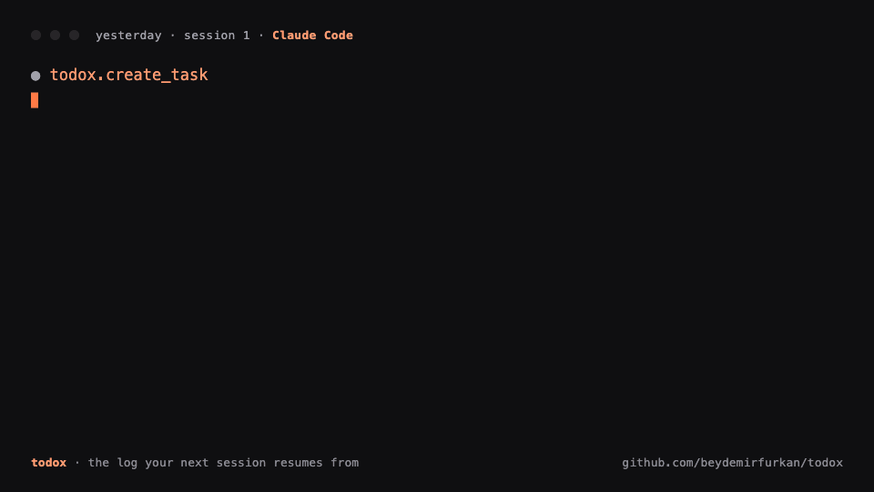
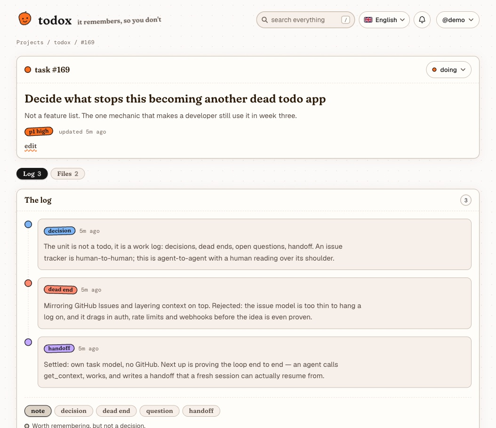
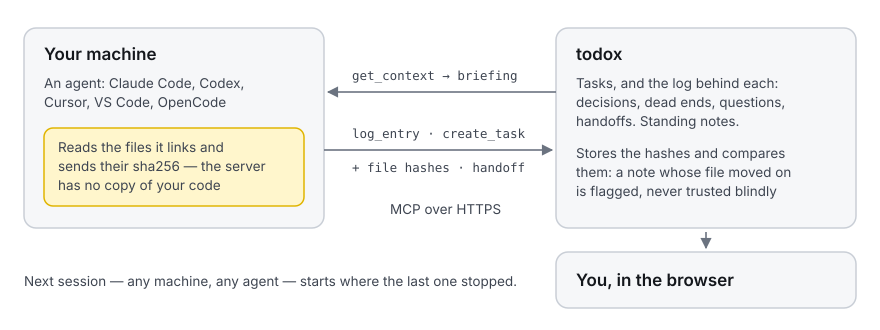
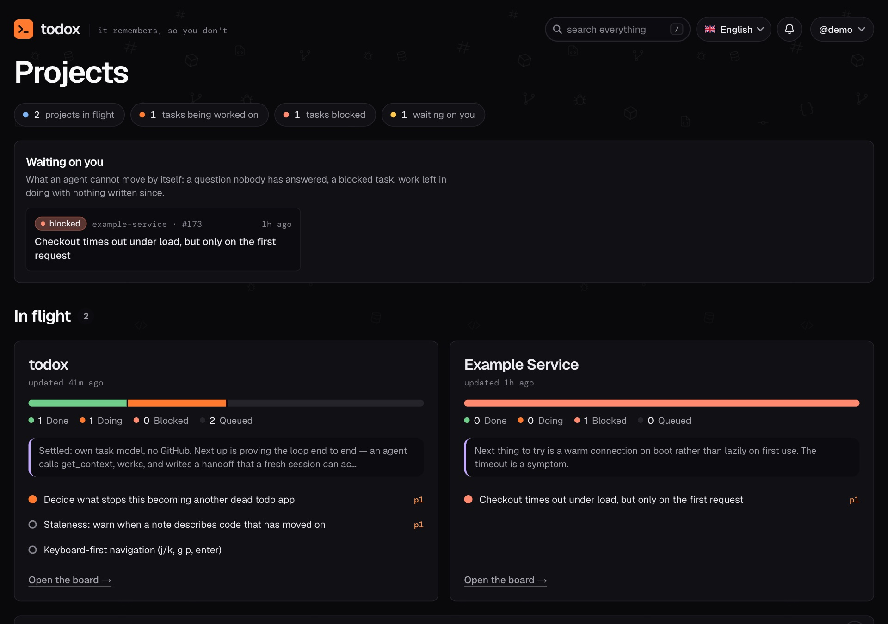
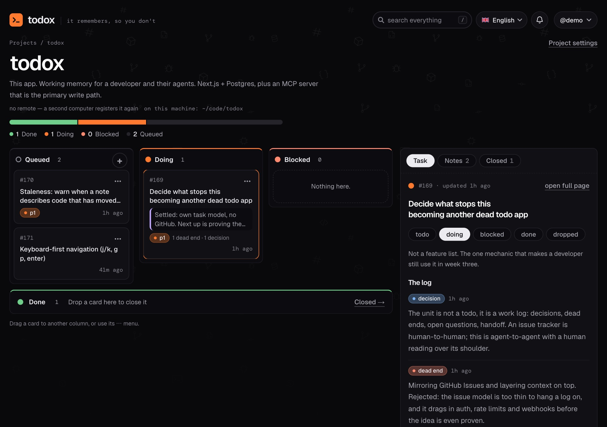

 for an eye and a cursor for a smile">

# todox

**Working memory for developers and their agents.**
Not a checklist. A log the next session can pick up from.

[](https://github.com/beydemirfurkan/todox/actions/workflows/ci.yml)
[](LICENSE)
[](https://www.todox.dev)

Agents forget everything between sessions. todox gives them a shared log:
what was decided, what failed, what is still open, and where the last
session stopped.

A new session calls `get_context` and starts where the last one left off,
without repeating a mistake somebody already made.

<p align="center">
  
</p>

The second session shows the real `get_context` output, trimmed, for the
entries the first one wrote. The same log in the browser:

<p align="center">
  
</p>

## How it works



Your agent writes. You read. There is one log per repository, whichever
machine or agent touched it last.

| Today | One project |
| --- | --- |
|  |  |

## What goes in a log

| kind | what it means |
| --- | --- |
| `decision` | what you chose, and why |
| `dead_end` | what did **not** work, so nobody tries it again |
| `question` | something only a human can answer |
| `handoff` | where the session stopped, written for a stranger |
| `note` | everything else |

What you get from that:

- **Stale notes are flagged.** The agent hashes the files a task links. When
  the code changes, the briefing says the note may be out of date.
- **Reports come from the log.** What got done today, how long it took, and
  which model did it.
- **Files have a history.** `get_file_context` lists the tasks and dead ends
  that touched a file.
- **The briefing has a budget.** It is capped in rows and bytes, and it says
  what it left out.

## Why not your agent's own memory?

Claude Code, Cursor and Codex each keep their own notes. They are good for
preferences like "use pnpm". But each one is tied to one machine and one
tool, and nobody else can read it.

todox covers the rest:

- **Two machines, one log.** A repository is identified by its git remote.
- **Every agent, one log.** Claude Code, Codex, Cursor, VS Code and
  OpenCode all speak MCP.
- **Shared with people.** Projects can be shared, and every entry says who
  wrote it and which model.
- **Real structure.** Tasks open and close, dead ends are their own kind, and
  stale notes say so.

### Compared with other memory servers

Based on each project's own README (read 2026-10-16). Where a README says
nothing, the cell says so.

| | todox | [MCP memory server](https://github.com/modelcontextprotocol/servers/tree/main/src/memory) | [Basic Memory](https://github.com/basicmachines-co/basic-memory) | [Mem0](https://github.com/mem0ai/mem0) |
| --- | --- | --- | --- | --- |
| Stores | tasks with a log; standing notes | a knowledge graph | Markdown notes | facts an LLM extracts |
| Lives in | Postgres, hosted or yours | a local JSONL file | files on your disk | a server or managed platform |
| Two machines | yes, by git remote | not described | Git, Syncthing or paid cloud | through the server |
| Dead ends as a kind | yes | not described | not described | not described |
| Notices changed code | yes, by file hash | not described | not described | not described |
| Needs an LLM key | no | not described | not described | yes |

A knowledge graph is good for facts about a person or a domain. todox is for
the state of work in a repository.

## Try it

**[todox.dev](https://www.todox.dev)**: sign up with email, Google or
GitHub. It is a small personal deployment with no uptime promise, so
self-host if the log matters to you.

## Run your own

```bash
pnpm install
cp .env.example .env.local     # any Postgres 15+
pnpm db:migrate
pnpm seed                      # optional demo account: demo / todox-demo
pnpm dev
```

## Connect an agent

Create a token on the Account page. It gives you text to paste into your
agent.

**Claude Code: the plugin.** It installs the server, the session habit and a
reminder at session start, and asks for the token once.
[`plugin/README.md`](plugin/README.md) has the details.

```bash
claude plugin marketplace add beydemirfurkan/todox
claude plugin install todox@todox
```

**Codex: the same plugin.** It reads the token from your environment. Codex
asks you to review the plugin's hooks before it runs them.

```bash
export TODOX_TOKEN=todox_…            # in your shell profile
codex plugin marketplace add beydemirfurkan/todox
codex plugin add todox@todox
```

**Any client, by hand.** One URL and one header:

```bash
# Claude Code without the plugin. --scope user, so it works in every project.
claude mcp add --scope user --transport http todox https://www.todox.dev/api/mcp \
  --header "Authorization: Bearer todox_…"
```

```toml
# Codex — ~/.codex/config.toml
[mcp_servers.todox]
url = "https://www.todox.dev/api/mcp"
http_headers = { Authorization = "Bearer todox_…" }
```

```json
// Cursor — ~/.cursor/mcp.json
{
  "mcpServers": {
    "todox": {
      "type": "http",
      "url": "https://www.todox.dev/api/mcp",
      "headers": { "Authorization": "Bearer todox_…" }
    }
  }
}
```

```json
// VS Code — user-level mcp.json ("MCP: Open User Configuration").
// The root key is "servers", not "mcpServers".
{
  "servers": {
    "todox": {
      "type": "http",
      "url": "https://www.todox.dev/api/mcp",
      "headers": { "Authorization": "Bearer todox_…" }
    }
  }
}
```

```json
// OpenCode v1 — ~/.config/opencode/opencode.json. Type is "remote".
{
  "mcp": {
    "todox": {
      "type": "remote",
      "url": "https://www.todox.dev/api/mcp",
      "headers": { "Authorization": "Bearer todox_…" }
    }
  }
}
```

```jsonc
// OpenCode v2 — the server moves under mcp.servers.
{
  "mcp": {
    "servers": {
      "todox": {
        "type": "remote",
        "url": "https://www.todox.dev/api/mcp",
        "headers": { "Authorization": "Bearer todox_…" }
      }
    }
  }
}
```

> **Get the key and the type right.** A wrong combination fails silently:
> the tools just never show up.
>
> | agent | key | `type` |
> | --- | --- | --- |
> | Claude Code | `mcpServers.NAME` | `"http"` |
> | OpenCode v1 | `mcp.NAME` | `"remote"` |
> | OpenCode v2 | `mcp.servers.NAME` | `"remote"` |
> | Cursor | `mcpServers.NAME` | `"http"` |
> | VS Code (Copilot Chat) | `servers.NAME` | `"http"` |
> | Codex | TOML `[mcp_servers.NAME]` | n/a |

Where the config file lives:

| agent | macOS | Linux | Windows |
| --- | --- | --- | --- |
| Claude Code | `~/.claude.json` | same | same |
| Cursor | `~/.cursor/mcp.json` | same | same |
| Codex | `~/.codex/config.toml` | same | same |
| OpenCode | `~/.config/opencode/opencode.json` | same | same |
| VS Code | `~/Library/Application Support/Code/User/mcp.json` | `~/.config/Code/User/mcp.json` | `%APPDATA%\Code\User\mcp.json` |

**Install it for your user, not for one project.** Most clients default to the
current directory, and a memory that exists in one repository is not much of
a memory.

### Then tell your agent to use it

A connected server is not a used one. Agents follow their memory file far more
reliably than a server's instructions. Add these lines to it:

```markdown
todox MCP is installed here — persistent memory across projects.

- Call `get_context` before starting non-trivial work (cwd = your working
  directory). It registers a new repo by itself.
- `create_task` for anything that will not finish this session.
- Before stopping, `session_status` lists what you touched; leave a
  `log_entry(kind:'handoff')` on each, and `dead_end` for approaches that failed.
- Always pass your own model id.
```

Or let the installer write them (`--dry-run` shows the block first):

```bash
pnpm install:mcp claude-code --write-memory
```

Use the user-level file, so it applies everywhere:

| Agent | The file that applies everywhere |
| --- | --- |
| Claude Code | `~/.claude/CLAUDE.md` |
| Codex | `~/.codex/AGENTS.md` |
| Cursor | `~/.cursor/rules/todox.md` |
| VS Code | `~/.copilot/instructions/todox.md` |
| OpenCode | `~/.config/opencode/AGENTS.md` |

If an account stays connected for days without calling a tool, the server
notices and asks the agent to add these lines itself.

**The full protocol as a skill.** The same text the server sends at startup
can live in your skills directory, where the client loads it only when it is
relevant:

```bash
pnpm install:mcp claude-code --write-skill
```

| Agent | The skill file it loads |
| --- | --- |
| Claude Code | `~/.claude/skills/todox/SKILL.md` |
| Codex | `~/.agents/skills/todox/SKILL.md` |
| Cursor | `~/.cursor/skills/todox/SKILL.md` |
| VS Code | `~/.copilot/skills/todox/SKILL.md` |
| OpenCode | `~/.config/opencode/skills/todox/SKILL.md` |

The token never goes in these files. It stays in your MCP config.

**Tools not showing up?** `doctor` reads each client's files the way the client
does and tells you what is wrong. It changes nothing.

```bash
npx https://github.com/beydemirfurkan/todox/releases/latest/download/todox-mcp.tgz doctor
```

### Optional: local mode

Over HTTP, the agent sends file hashes itself. The local stdio server does the
hashing for you, so staleness works even when the agent forgets:

```bash
TODOX_TOKEN=todox_… TODOX_URL=https://www.todox.dev \
  npx https://github.com/beydemirfurkan/todox/releases/latest/download/todox-mcp.tgz
```

As an MCP config:

```json
{
  "mcpServers": {
    "todox": {
      "command": "npx",
      "args": [
        "-y",
        "https://github.com/beydemirfurkan/todox/releases/latest/download/todox-mcp.tgz"
      ],
      "env": { "TODOX_TOKEN": "todox_…", "TODOX_URL": "https://www.todox.dev" }
    }
  }
}
```

There is no npm package, on purpose. A GitHub Release needs no account to
publish or install. Each release also carries `todox-mcp-<version>.tgz` if
you want to pin a version.

### Optional: a git hook

The briefing can show what git did while an earlier session ran. The plugin
and the local server record that for their own sessions. For anything else,
install the hook per repository:

```bash
cd your-repo
npx https://github.com/beydemirfurkan/todox/releases/latest/download/todox-mcp.tgz hook install --token todox_…
```

After each commit it sends counts, the branch and up to three commit subjects,
never a diff, in the background. `hook status` and `hook uninstall` do what
they say. Repositories managed by husky or lefthook are not edited; it prints
the line to add instead.

### Tools

| tool | what it does |
| --- | --- |
| `get_context` | **Call first.** Rules, decisions, dead ends, open tasks and stale-file warnings for a project. Pass `focus` to spend the budget on what matters for this session. `shape: "digest"` returns a plain-text version. |
| `get_developer` | Who the developer is: profile, standing rules, projects and the last 30 days. No project needed. |
| `create_task` | Capture work that will outlive this session. Warns about related dead ends. |
| `update_task` | Status, title, body, priority. `doing` and `done` are where durations come from. |
| `log_entry` | Add a decision, dead end, question, handoff or note. `answers_entry_id` closes a question. |
| `delete_entry` | Remove an entry that was wrong when written. |
| `activity_report` | What got done in a period, with durations and models. `format: "markdown"` for a status update. |
| `link_files` | Attach files (with hashes) or URLs to a task or note. |
| `report_file_hashes` | Hosted only: send the current hashes of linked files. |
| `accept_file_change` · `unlink_file` | Clear a stale warning, or drop a link. |
| `add_context` | A note that outlives a task. Leave out the project to make it account-wide. |
| `get_context_note` | One note in full. |
| `get_file_context` | Tasks, dead ends and notes attached to one file. |
| `session_status` | **Call before finishing.** What you touched and which tasks still need a handoff. |
| `update_context` · `delete_context` | Fix or remove a note. |
| `search` | Search every project, in English or Turkish. `kinds` narrows to dead ends or decisions. |
| `get_task` | One task with its log and files. |
| `list_tasks` · `list_projects` | The plain lists. |
| `create_project` · `update_project` | Rarely needed: `create_task` with a `cwd` registers a project. |
| `delete_project` | Undo a mistyped `cwd`. `confirm` must be the slug. |
| `merge_projects` | Merge a repository that was registered twice. |

Every write tool takes a `model`, so reports know which model did what.

### Prompts

| prompt | when |
| --- | --- |
| `start_session` | before planning |
| `wrap_up` | before finishing |
| `standup` | when somebody asks what got done |

## Deploying

One app container and one Postgres. `docker-compose.yml` has both, and the
database publishes no port:

```bash
cp .env.example .env       # set POSTGRES_PASSWORD and TODOX_PUBLIC_URL
docker compose up -d --build
docker compose exec app pnpm db:migrate
```

| variable | why |
| --- | --- |
| `DATABASE_URL` | Postgres. |
| `DATABASE_POOL_MAX` | Optional, default 20. Connections per process. |
| `TODOX_SLOW_MS` | Optional, default 50. A statement slower than this is logged as `db.slow`. |
| `TRUSTED_PROXY_HOPS` | Optional, default 1. Proxies between the internet and the app; the rate limits read the client address from it. 0 if nothing forwards to the app. |
| `TODOX_PUBLIC_URL` | Mail links and the agent setup snippet are built from it. |
| `TODOX_REGISTRATION` | Optional. `closed` stops new accounts, by password and by Google or GitHub; an invitation to a project still works. Unset, anyone can register. |
| `SMTP_HOST` · `SMTP_USER` · `SMTP_PASS` · `MAIL_FROM` (· `SMTP_PORT`) | Optional. Port defaults to 587. Without them, production sends no mail: no verification and no password reset. `pnpm user:verify <email>` vouches for an address from the server, which is what invites and sharing need. |
| `GOOGLE_CLIENT_ID` · `GOOGLE_CLIENT_SECRET` / `GITHUB_CLIENT_ID` · `GITHUB_CLIENT_SECRET` | Optional, in pairs. Each turns on its sign-in button. Callback: `<TODOX_PUBLIC_URL>/api/auth/<google\|github>/callback`. |

**Serve it over HTTPS.** In production the session cookie is `Secure` and the
app sends HSTS, so over plain HTTP — a LAN address, say — the browser drops the
cookie and sign-in appears to do nothing. Put a reverse proxy with a
certificate in front (Caddy, Traefik, nginx), and count it in
`TRUSTED_PROXY_HOPS`.

`pnpm db:migrate` does not run at startup, so two instances never race on the
schema. Run it after a deploy that changes the schema:

```bash
docker exec <container> pnpm db:migrate
```

**A merge is not a deploy.** The image tag is the git sha. Compare
`docker inspect <container> --format '{{.Config.Image}}'` with
`git rev-parse origin/main` to see what is really running.

## Your data

**Download my data** on the Account page, or `/api/export` with a token, gives
you every project you own: tasks, log, notes and file hashes. Nothing about
anyone else.

```bash
pnpm db:import ./todox-export-2026-08-18.json your-username
```

Import only adds. It never deletes or overwrites.

## Security

Passwords use scrypt. Sessions, tokens and email links are stored only as
hashes. Another user's row answers 404, so ids cannot be probed. Rate limits
live in the database. The full picture, including what is not covered, is in
[SECURITY.md](SECURITY.md).

## Known gaps

- Search finds identifiers through `pg_trgm`. Without that extension, that half
  of search is slower.
- Staleness is per file, not per function. Hosted, it depends on the agent
  sending hashes.
- Observations show what changed, never why, and need the plugin, the local
  server or the git hook.
- The UI is checked by eye more than by tests.
- No 2FA, no per-session revocation, no audit log.
- Share links are unlisted, not access-controlled.

## Cutting a release

```bash
git tag vX.Y.Z && git push origin vX.Y.Z    # the version in package.json
```

The workflow checks the tag, runs the checks, and attaches the stdio package
to a GitHub Release. `server.json` and the tag must match, or the release
stops.

## Contributing

Rules and checks: [CONTRIBUTING.md](CONTRIBUTING.md). MIT — see
[LICENSE](LICENSE).
